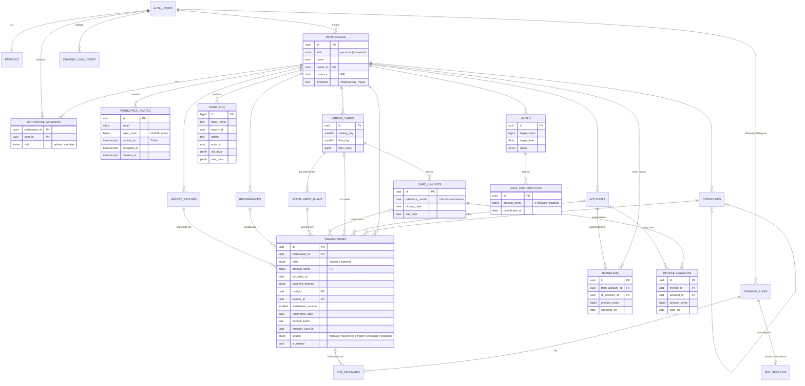

# Modelo de dados

> Responsável: **Arquiteto de Software**. Fonte da verdade: `supabase/migrations/*.sql`.
> Tipos TypeScript gerados em `src/lib/supabase/database.types.ts` (`pnpm db:types`).

## Ideia central: tudo pertence a um *workspace*

Em vez de ter tabelas separadas para "dados pessoais" e "dados da família", **todo dado financeiro tem
`workspace_id`**. Um workspace é **individual** (`personal`, criado no cadastro, só o dono) ou **familiar**
(`household`, com membros convidados). Assim, a mesma tela e a mesma regra servem para os dois casos,
e alternar de espaço é só mudar o `workspace_id` ativo.

## Diagrama (ER)

## Tabelas

### Núcleo (migration 0001)
| Tabela | Para quê | Observações |
|---|---|---|
| `profiles` | Nome, avatar e **último espaço ativo** de cada usuário | Criado por trigger no cadastro. `last_workspace_id` só aceita espaços onde o usuário é membro (política RLS). |
| `workspaces` | Espaços individuais e familiares | Índice único garante **1 espaço pessoal por usuário**. `kind` e `owner_id` imutáveis (trigger). |
| `workspace_members` | Quem participa e com qual papel | Trigger: dono sempre admin, nunca removido; espaço pessoal só aceita o dono. |
| `workspace_invites` | Convites | Só o **hash** do token é salvo. Coluna `token_hash` não é legível pelo cliente (privilégio de coluna). |

### Domínio financeiro (migration 0002)
| Tabela | Para quê | Observações |
|---|---|---|
| `accounts` | Contas bancárias/carteira | `initial_balance_cents`; `owner_user_id` = titular (membro). |
| `credit_cards` | Cartões | `closing_day`/`due_day` 1–31 (dias inexistentes → último dia do mês). |
| `card_invoices` | Faturas | Única por (cartão, mês de vencimento). `status = paid` ⇔ `paid_at` preenchido. |
| `categories` | Categorias | 22 padrões copiadas para **cada** espaço novo (trigger), personalizáveis. Nome único por (espaço, tipo). |
| `recurrences` | Receitas/despesas fixas | Geram `transactions` com `(recurrence_id, recurrence_month)` único → idempotente. |
| `installment_plans` | Compra parcelada | 2–48 parcelas; cada parcela é uma `transaction` com `installment_number`. |
| `import_batches` | Importações CSV/OFX | Contadores de linhas importadas/duplicadas; permite reverter. |
| `transactions` | Lançamentos | Ver restrições abaixo. |
| `goals` / `goal_contributions` | Metas e aportes | Aporte negativo = resgate. |

**Restrições importantes de `transactions`** (todas no banco, não só na app):
- `amount_cents > 0`; categoria do mesmo tipo do lançamento (trigger).
- `payment_method = 'credit'` ⇔ tem `card_id` ⇔ tem `invoice_id`; receitas não podem ser no crédito.
- A fatura precisa ser **do mesmo cartão** (FK composta `(invoice_id, card_id)`).
- `member_user_id` precisa ser membro do espaço (trigger).
- Índices únicos: (recorrência, mês), (parcelamento, nº da parcela), (espaço, `dedupe_hash`).

### Canais de mensagem (migration 0003)
| Tabela | Para quê |
|---|---|
| `channel_links` | Número de WhatsApp / chat do Telegram ↔ usuário, com espaço padrão para lançamentos. |
| `channel_link_codes` | Códigos de vinculação (hash, expira em 10 min, uso único). Sem acesso do cliente. |
| `bot_messages` | Log de mensagens: idempotência (id externo único), auditoria e "desfazer". |
| `bot_sessions` | Estado de conversa (perguntas de esclarecimento pendentes). Só servidor. |
| `rate_limits` | Contadores de janela fixa para limitar a taxa (sem Redis → custo zero). Só servidor. |

### Diretório (migration 0004)
`get_workspace_members(workspace_id)` — RPC que devolve nome + **e-mail** dos membros (e-mails vivem em
`auth.users`, inacessível ao cliente), somente para quem participa do espaço.

### Fase 2 (migration 0006)
| Item | O que é |
|---|---|
| `transfers` | Transferência entre duas contas do mesmo espaço. **Não** é receita nem despesa. |
| `invoice_payments` | Pagamento (total ou parcial) de uma fatura, saindo de uma conta. **Não** é despesa (ADR-0010). |
| `audit_log` | Trilha de auditoria: quem, quando, antes/depois (jsonb). Leitura para membros; escrita só por trigger. |
| `card_invoices` | Perdeu `status/paid_at/...`: agora tudo isso é **calculado**. Criada sob demanda por `private.ensure_invoice`. |
| `categories.parent_id` | Subcategoria (1 nível, mesmo tipo da mãe). FKs para categoria agora são `RESTRICT`. |
| `recurrences` | `frequency` (semanal/mensal/anual), `auto_confirm`, `last_generated_on`. |
| `transactions` | `recurrence_date` (data da ocorrência) e `updated_by`. Fatura atribuída por trigger no crédito. |

**Views calculadas** (`security_invoker = true` → respeitam a RLS de quem consulta):
| View | Calcula |
|---|---|
| `account_balances` | Saldo confirmado e previsto de cada conta (RN-52). |
| `card_invoice_summaries` | Total, pago, restante, nº de itens e **status** de cada fatura (RN-54). |
| `credit_card_summaries` | Limite usado e disponível de cada cartão (RN-55). |

**Funções principais**
| Função | Uso |
|---|---|
| `private.invoice_cycle(fecha, vence, data)` | Regra da fatura (RN-10). Espelho em `src/lib/domain/invoice.ts`. |
| `create_card_purchase(...)` | Compra no cartão à vista ou em N parcelas (RN-11), numa única transação. |
| `update_installments / delete_installments(id, escopo)` | Parcelas: só esta / esta e as próximas / todas. |
| `private.generate_recurrence` + job pg_cron `gerar-recorrencias` | Geração idempotente (RN-14…18). |
| `apply_recurrence_to_future(id)` | Refaz os previstos a partir de hoje após editar. |
| `delete_category(id, destino)` | Exclui reatribuindo lançamentos (RN-19). |
| `restore_deleted_transaction(id)` | Desfazer exclusão a partir da auditoria (RN-58). |

### Fase 3 — camada analítica (migration 0007)
Nada novo é **armazenado** (só a preferência `profiles.hide_amounts`). Todo número do painel é calculado
por funções SQL **`SECURITY INVOKER`**: rodam com a sessão de quem chama, então a RLS das tabelas vale
dentro delas (uma família nunca soma lançamentos de outra). Todas recebem `p_workspace_id` e os filtros
opcionais `p_category_id` (inclui subcategorias), `p_member_id`, `p_account_id`, `p_card_id`.

| Função | Devolve |
|---|---|
| `analytics_entries(ws, de, até, visão, …)` | Base: lançamentos do período com `bucket_date` (data na visão escolhida), `is_planned`, membro efetivo e categoria-raiz. |
| `analytics_totals(…)` | Receitas e despesas, realizado e previsto separados, nº de lançamentos. |
| `analytics_monthly(…)` | Série mês a mês (inclui meses vazios com zero). |
| `analytics_by_category(…, tipo)` | Total por categoria-folha + `parent_id` (o app soma no pai). |
| `analytics_by_member(…)` / `analytics_by_source(…)` | Por membro / por cartão ou conta. |
| `analytics_position(ws, até, conta?, cartão?)` | Saldo atual (ou numa data passada), faturas em aberto e a vencer, limite, previstos e **saldo projetado** (RN-65). |
| `analytics_upcoming(ws, dias)` | Contas previstas e faturas não quitadas que vencem até hoje + N dias (inclui vencidas). |

Tipo novo: `analytics_basis` = `accrual` (competência) | `cash` (caixa). Valor inválido → erro `22P02`.

**Índices novos** (planos medidos com 200 mil lançamentos em 100 espaços, ver ADR-0015):
`card_invoices (workspace_id, due_date)` · `transactions (account_id)` e `(card_id)` parciais ·
`transfers (from_account_id)`, `(to_account_id)` · `invoice_payments (account_id)` ·
`transactions (workspace_id, occurred_on) where not is_settled`.

**Correção**: `create_card_purchase` recriada — a 1ª compra parcelada num cartão sem fatura no ciclo falhava
(a fatura criada dentro de um subselect não era visível no mesmo comando).

### Fase 4 — metas e projeção (migration 0008)
| Item | O que é |
|---|---|
| `goals` (novos campos) | `priority` (1 alta · 2 média · 3 baixa), `initial_cents` (já guardado ao criar), `reserve_account_id` (conta de reserva/caixinha, opcional), `annual_return_bps` (rendimento estimado em pontos-base), `notes`. Status ganhou `paused`. |
| `goal_contributions` (novos campos) | Valor positivo = aporte, negativo = retirada (**exige motivo** em `note`). `is_planned` (previsto), `recurrence_id`/`recurrence_date` (aporte planejado, único por data), `updated_at`. |
| `recurrences.goal_id` | Recorrência de **aporte planejado**: o gerador cria aportes previstos em `goal_contributions` em vez de lançamentos. |
| `goal_summaries` (view, `security_invoker`) | Guardado, depositado, retirado, previsto, nº de aportes, último aporte e o plano ativo de cada meta. |

**Regras no banco**: `validate_goal_contribution` (meta arquivada não recebe; retirada não passa do
guardado), `sync_goal_status` (concluída/ativa automática), auditoria em metas e aportes.
**Saldos**: `account_balances` e `analytics_position` descontam o aporte confirmado da conta de origem e somam
na conta de reserva (ADR-0016).

**Motor de projeção** (ADR-0017): `private.projected_occurrences(ws, de, até)` → ocorrências virtuais das
recorrências ativas após o horizonte gerado; `analytics_entries` ganhou `p_include_projected` (padrão true) e as
colunas `is_projected`/`is_fixed`; `analytics_position` ganhou `planned_savings_cents`.

| Função nova | Devolve |
|---|---|
| `analytics_savings(ws, de, até, membro?, conta?)` | Guardado no período (aportes − retiradas), depósitos, retiradas e previstos. |
| `planning_capacity_inputs(ws, meses = 6)` | Por mês (N fechados + próximo projetado): receitas fixas/eventuais, despesas fixas/variáveis e guardado. O cálculo final é puro em TS (`savingsCapacity`). |

### Fase 5 — assistente (migration 0009)
| Tabela | O que é | Quem vê |
|---|---|---|
| `assistant_messages` | Histórico do chat (texto + resposta estruturada em `payload`), por canal | Só o próprio usuário (apagável) |
| `assistant_sessions` | Estado da conversa (aguardando confirmação/escolha), expira em 15 min | Só o próprio usuário |
| `assistant_actions` | Cada gravação do assistente: lote (`batch_id`), intenção, **mensagem original**, registro criado, como desfazer, provedor | Só o próprio usuário; auditada |
| `category_rules` | Regras aprendidas "texto → categoria" | Membros do espaço |
| `assistant_usage` | Contador de chamadas de IA por usuário/dia/provedor | Leitura do próprio; escrita só pela função |

`entry_source` ganhou `assistant`. Função `assistant_take_quota(provedor, limite_dia, limite_minuto)` — atômica,
devolve `allowed`/`used_today`/`reason`. Job `limpar-assistente` (pg_cron) limpa sessões e uso antigos.

### Fase 6 — Telegram, fotos/áudio e notificações (migration 0010)
| Tabela | O que é | Quem vê |
|---|---|---|
| `telegram_updates` | `update_id` recebidos (idempotência), tipo, status, erro — **sem conteúdo** | Só o servidor |
| `push_subscriptions` | Assinatura Web Push por aparelho (endpoint + chaves) | Só o próprio usuário |
| `notification_settings` | Horário de silêncio | Só o próprio usuário |
| `notification_prefs` | Por tipo: ligado, push, Telegram | Só o próprio usuário |
| `notifications` | Central (lidas/não lidas), `unique(user_id, event_key)` = nunca duplica | Leitura/“marcar lida”/apagar do próprio; criação só pelo sistema |
| `notification_deliveries` | Fila por canal com tentativas, próximo envio e erro (dead-letter) | Só o servidor |

`assistant_actions`/`assistant_messages` ganharam `input_kind` (`text`/`photo`/`audio`). `assistant_usage` aceita
`gemini-image`, `groq-audio`, `gemini-audio` (cotas próprias). `consume_channel_link_code` passou a manter **um chat
por usuário**. Funções: `private.generate_notifications` (pg_cron `notificacoes`, 15 min), `private.notify`
(respeita preferências, idempotente), triggers de meta atingida e lançamento de outro membro,
`claim_notification_deliveries` (SKIP LOCKED + silêncio) e `finish_notification_delivery` (retentativa → dead),
`private.run_notifications` (gera + chama o app via pg_net com segredo do Vault). View `ops_dead_letters` (só servidor).

### Ciclo de vida da conta (migration 0005)
`transfer_workspace_ownership`, `get_account_deletion_blockers`, `delete_my_account` (ADR-0013).

## Isolamento: como a RLS funciona aqui

1. **Helpers no schema `private`** (não exposto pela API): `my_workspace_ids()`, `is_member(ws)`,
   `is_admin(ws)`. São `SECURITY DEFINER` para evitar recursão de RLS e usam `search_path = ''`.
2. **Políticas padrão** em toda tabela financeira:
   - `SELECT/INSERT/UPDATE`: `workspace_id in (select private.my_workspace_ids())`
   - `DELETE`: membro do espaço **e** (`created_by = auth.uid()` **ou** admin)
   - `transactions`/`goal_contributions`: `UPDATE` também exige autor ou admin.
3. **FKs compostas** `(x_id, workspace_id)`: impossível, no nível do banco, uma transação apontar para
   cartão/categoria/conta de **outro** espaço — mesmo que alguém burle a aplicação.
4. **Triggers de proteção**: `created_by` forçado para o usuário logado; `workspace_id`, `created_by`,
   `created_at`, `owner_id` imutáveis.
5. **Privilégios**: `anon` não tem acesso a nenhuma tabela; colunas sensíveis (ex.: `token_hash`) não
   têm `SELECT` para `authenticated`; tabelas do bot não têm acesso de cliente algum.
6. **Operações sensíveis via RPC** com checagens explícitas: `create_household`, `create_workspace_invite`,
   `get_invite_preview`, `accept_workspace_invite`, `create_channel_link_code`. As de servidor
   (`consume_channel_link_code`, `hit_rate_limit`) só podem ser executadas pela `service_role`.

Tudo isso é coberto por testes pgTAP em `supabase/tests/database/` (`pnpm test:db`).

## Convenções
- Dinheiro: `bigint` em centavos, sufixo `_cents`.
- Datas de competência: `date`; instantes: `timestamptz`; "mês" = `date` no dia 1 (`*_month`).
- Nomes em inglês no banco/código; textos de interface em pt-BR.
- Migrations **nunca são editadas** depois de aplicadas em algum ambiente: crie uma nova.
