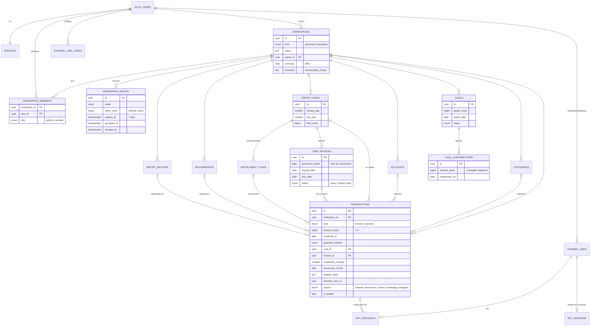

# Modelo de dados

> Responsável: **Arquiteto de Software**. Fonte da verdade: `supabase/migrations/*.sql`.
> Tipos TypeScript gerados em `src/lib/supabase/database.types.ts` (`pnpm db:types`).

## Ideia central: tudo pertence a um *workspace*

Em vez de ter tabelas separadas para "dados pessoais" e "dados da família", **todo dado financeiro tem
`workspace_id`**. Um workspace é **individual** (`personal`, criado no cadastro, só o dono) ou **familiar**
(`household`, com membros convidados). Assim, a mesma tela e a mesma regra servem para os dois casos,
e alternar de espaço é só mudar o `workspace_id` ativo.

## Diagrama (ER)

## Tabelas

### Núcleo (migration 0001)
| Tabela | Para quê | Observações |
|---|---|---|
| `profiles` | Nome, avatar e **último espaço ativo** de cada usuário | Criado por trigger no cadastro. `last_workspace_id` só aceita espaços onde o usuário é membro (política RLS). |
| `workspaces` | Espaços individuais e familiares | Índice único garante **1 espaço pessoal por usuário**. `kind` e `owner_id` imutáveis (trigger). |
| `workspace_members` | Quem participa e com qual papel | Trigger: dono sempre admin, nunca removido; espaço pessoal só aceita o dono. |
| `workspace_invites` | Convites | Só o **hash** do token é salvo. Coluna `token_hash` não é legível pelo cliente (privilégio de coluna). |

### Domínio financeiro (migration 0002)
| Tabela | Para quê | Observações |
|---|---|---|
| `accounts` | Contas bancárias/carteira | `initial_balance_cents`; `owner_user_id` = titular (membro). |
| `credit_cards` | Cartões | `closing_day`/`due_day` 1–31 (dias inexistentes → último dia do mês). |
| `card_invoices` | Faturas | Única por (cartão, mês de vencimento). `status = paid` ⇔ `paid_at` preenchido. |
| `categories` | Categorias | 22 padrões copiadas para **cada** espaço novo (trigger), personalizáveis. Nome único por (espaço, tipo). |
| `recurrences` | Receitas/despesas fixas | Geram `transactions` com `(recurrence_id, recurrence_month)` único → idempotente. |
| `installment_plans` | Compra parcelada | 2–48 parcelas; cada parcela é uma `transaction` com `installment_number`. |
| `import_batches` | Importações CSV/OFX | Contadores de linhas importadas/duplicadas; permite reverter. |
| `transactions` | Lançamentos | Ver restrições abaixo. |
| `goals` / `goal_contributions` | Metas e aportes | Aporte negativo = resgate. |

**Restrições importantes de `transactions`** (todas no banco, não só na app):
- `amount_cents > 0`; categoria do mesmo tipo do lançamento (trigger).
- `payment_method = 'credit'` ⇔ tem `card_id` ⇔ tem `invoice_id`; receitas não podem ser no crédito.
- A fatura precisa ser **do mesmo cartão** (FK composta `(invoice_id, card_id)`).
- `member_user_id` precisa ser membro do espaço (trigger).
- Índices únicos: (recorrência, mês), (parcelamento, nº da parcela), (espaço, `dedupe_hash`).

### Canais de mensagem (migration 0003)
| Tabela | Para quê |
|---|---|
| `channel_links` | Número de WhatsApp / chat do Telegram ↔ usuário, com espaço padrão para lançamentos. |
| `channel_link_codes` | Códigos de vinculação (hash, expira em 10 min, uso único). Sem acesso do cliente. |
| `bot_messages` | Log de mensagens: idempotência (id externo único), auditoria e "desfazer". |
| `bot_sessions` | Estado de conversa (perguntas de esclarecimento pendentes). Só servidor. |
| `rate_limits` | Contadores de janela fixa para limitar a taxa (sem Redis → custo zero). Só servidor. |

### Diretório (migration 0004)
`get_workspace_members(workspace_id)` — RPC que devolve nome + **e-mail** dos membros (e-mails vivem em
`auth.users`, inacessível ao cliente), somente para quem participa do espaço.

## Isolamento: como a RLS funciona aqui

1. **Helpers no schema `private`** (não exposto pela API): `my_workspace_ids()`, `is_member(ws)`,
   `is_admin(ws)`. São `SECURITY DEFINER` para evitar recursão de RLS e usam `search_path = ''`.
2. **Políticas padrão** em toda tabela financeira:
   - `SELECT/INSERT/UPDATE`: `workspace_id in (select private.my_workspace_ids())`
   - `DELETE`: membro do espaço **e** (`created_by = auth.uid()` **ou** admin)
   - `transactions`/`goal_contributions`: `UPDATE` também exige autor ou admin.
3. **FKs compostas** `(x_id, workspace_id)`: impossível, no nível do banco, uma transação apontar para
   cartão/categoria/conta de **outro** espaço — mesmo que alguém burle a aplicação.
4. **Triggers de proteção**: `created_by` forçado para o usuário logado; `workspace_id`, `created_by`,
   `created_at`, `owner_id` imutáveis.
5. **Privilégios**: `anon` não tem acesso a nenhuma tabela; colunas sensíveis (ex.: `token_hash`) não
   têm `SELECT` para `authenticated`; tabelas do bot não têm acesso de cliente algum.
6. **Operações sensíveis via RPC** com checagens explícitas: `create_household`, `create_workspace_invite`,
   `get_invite_preview`, `accept_workspace_invite`, `create_channel_link_code`. As de servidor
   (`consume_channel_link_code`, `hit_rate_limit`) só podem ser executadas pela `service_role`.

Tudo isso é coberto por testes pgTAP em `supabase/tests/database/` (`pnpm test:db`).

## Convenções
- Dinheiro: `bigint` em centavos, sufixo `_cents`.
- Datas de competência: `date`; instantes: `timestamptz`; "mês" = `date` no dia 1 (`*_month`).
- Nomes em inglês no banco/código; textos de interface em pt-BR.
- Migrations **nunca são editadas** depois de aplicadas em algum ambiente: crie uma nova.
